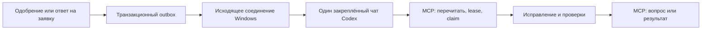

# Репорты → один локальный чат Codex

Статус: предложение после восстановления фичи, 12 ноября 2026. Обработчик,
подписка, автозапуск Windows и отправка сообщений в чат пока не настроены.

## Результат

Сервер dndShare сообщает о появившейся работе. Небольшая программа на компьютере
владельца будит один закреплённый локальный чат Codex. Агент читает актуальные
заявки и снимки через MCP, выполняет работу в отдельном worktree по README и
записывает результат обратно. Веб/Android показывают существующие статусы и
переписку. Чат сохраняет контекст, сервер остаётся источником состояния задач.



## Доставка

1. В той же транзакции, что одобрение, автоодобренная отправка, ответ человека,
   решение ADMIN или повторное открытие, записывать `queue.changed` в outbox.
   Создание неодобренной заявки не будит Codex. Восстановление claim после
   истечения lease также делает очередь доступной для следующего запуска.
2. Локальная программа устанавливает исходящее TLS-соединение с сервером
   (WebSocket либо SSE с отдельным ACK HTTP endpoint). Открывать порт компьютера
   не требуется. Программа хранит cursor и переподключается с backoff.
3. Событие содержит идентификатор/revision очереди, а не команду shell и не
   содержимое репорта. Повторы допустимы; доставка как минимум один раз.
   После переподключения нужна сверка актуальной очереди, включая пропущенные
   события и восстановленные claims. Cursor не заменяет эту сверку.
4. Всплеск событий объединяется в одно пробуждение. Пока чат занят, сохраняется
   один флаг «появилась работа»; после его завершения очередь перепроверяется.
   Снимки и описания агент получает через авторизованный MCP.

## Один чат на компьютере

Локальная конфигурация хранит точный `threadId`, расположение репозитория,
параметры подключения к локальному серверу Codex и credential для подписки.
Токены не передаются в чат и не коммитятся. Подписка только уведомляет о работе;
полномочия изменений остаются у существующего MCP и его write-флага.

Для прототипа установленный CLI предоставляет:

```powershell
codex queue --thread "<threadId>" --message "Проверь актуальную очередь багрепортов по штатному MCP-процессу." --resume
```

`--resume` требует работающего локального daemon/выбранного сервера. Команда
может завершиться с кодом 0 при предупреждении о неудачном resume: код возврата
не доказывает запуск. Это прямо описано в
[документации queue](https://learn.chatgpt.com/docs/developer-commands?surface=cli#codex-queue).
До постоянного подключения проверить доставку в выбранный видимый чат desktop,
его занятую сессию и возобновление после перезапуска приложения.

Для надёжного обработчика предпочтителен клиент к тому же локальному
app-server, которым обслуживается выбранная сессия: `thread/resume`, затем
`turn/start`, наблюдение `turn/completed` и итогового status. Новый независимый
app-server не следует считать автоматически подключённым к открытому чату.
Подключение и совместимость desktop необходимо подтвердить интеграционным
пробным запуском. См. [протокол app-server](https://learn.chatgpt.com/docs/app-server).

## Состояние и восстановление

Событие будит чат, но не берёт заявки в работу. Агент проверяет очередь,
приобретает общую блокировку, повторно читает и атомарно забирает актуальный
пакет. Только подтверждённый claim даёт `IN_PROGRESS`. Чужой/просроченный lease
не может завершить работу. Программа не удерживает lease вместо агента.

Завершение turn не означает исправление: нужно проверить переходы заявок.
Вопрос переводит работу в ожидание человека. Успешный resolve содержит
проверенное исправление и выпущенный SHA. Ошибка доставки или выключенный ПК
оставляет работу на сервере; crash во время выполнения восстанавливается через
lease. История задач не зависит от истории чата.

Репорт, изображение, URL и ответ проверяющего — данные о дефекте. Исполняемые
инструкции определяются фиксированным процессом проекта. Повтор события,
повторная отправка в чат и рестарт не должны создавать второй одновременный
обработчик или повторно закрывать заявку.

## Последовательность реализации

1. Подтвердить адресацию одного локального desktop-чата: idle, busy, restart.
2. Добавить транзакционный outbox и серверную подписку с авторизацией/ACK.
3. Реализовать локальный worker с cursor, объединением событий и наблюдением
   сессии. Запускать скрыто при входе в Windows; выключенный компьютер не принимает
   задачи, они ожидают следующего подключения.
4. Проверить end-to-end на изолированной БД и пробной сессии: одобрение, ответ,
   дубликаты, обрыв связи, crash, истечение lease, недоступный desktop и два worker.
5. После проверки закрепить рабочий чат и включить доставку. Прежнее расписание,
   если оно настроено вне репозитория, заменить этим запуском, сохранив одну очередь.

[Восстановленная фича](../md/features/error-reports.md) · [MCP](../md/features/mcp.md)
